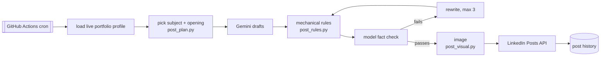

# CurioSync

[](https://github.com/Deshraj-Jogiya/curiosync/actions/workflows/daily_post.yml) 

A LinkedIn publishing pipeline that runs on GitHub Actions. Three times a week it drafts a post about my own work from the live portfolio
data, checks every claim against those facts, renders an image from the project's own details, and publishes through the LinkedIn Posts
API. It also writes a daily learning note to a separate repository.

## Highlights

- **Grounded drafting:** Gemini writes only from the live portfolio profile and the owner's own notes; subjects are scored by relevance
  to data and ML roles, recency and depth, and recent subjects, openings and wording are not repeated.
- **Fact checks before anything is published:**
  - Mechanical rules reject any number or tool not in the facts, "we" on solo work, undisclosed simulated data, filler words, engagement
    bait, and posts outside the length window.
  - A second model pass flags invented capabilities and cause-and-effect claims.
  - A draft that still fails after three rewrites is skipped, never posted.
- **Images from the work itself:** a real screenshot where one exists, otherwise a 1080×1350 card whose text is checked against the facts
  and shrunk to fit rather than cut off.
- **$0 hosting:** everything runs on GitHub Actions cron; posts are sent through the LinkedIn Posts API with reserved characters escaped.
- **Control panel:** a Jinja2/HTMX panel with Fernet-encrypted LinkedIn credentials.

## Architecture



## Stack

Python, FastAPI, Gemini (OpenAI-compatible API), LinkedIn Posts API, Pillow, Jinja2, HTMX, SQLAlchemy, pytest, GitHub Actions.

## Run it

```bash
pip install -r requirements.txt
cp .env.example .env          # fill in your own keys
python -m pytest -q
python -m github_cron draft   # drafts today's post (needs the environment variables the workflow sets)
```
